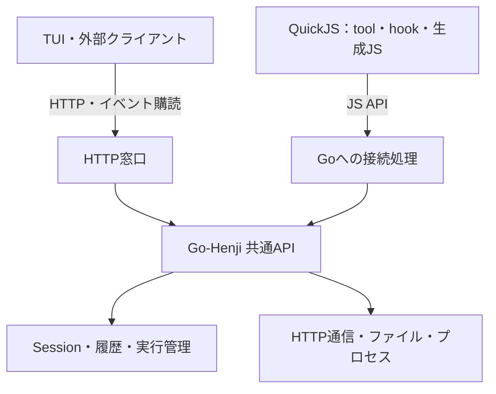

# Go＋QuickJSによるHenji後継Harnessの議論メモ

2026-10-10の会話を、目的、利用者の要求、確認した現行機能、仮決定、未決事項に分けて保存する。
実装計画ではなく、既存のconcept本文・現行Henjiのarchitecture・roadmapを変更する文書でもない。
後継コードの実装、性能測定、後継の機能確認はまだ行っていない。

このメモの作成後、利用者は完全移植ではなく、構想・機能を引き継ぎGoの特性を活かす後継Harnessと位置付けた。
上位計画へ５点を記載し、スパイクで確認する方針を採用している。
現在の上位計画は[GoによるHenji後継Harness](../../go-henji-successor/README.md)を参照する。

## 現在の仮決定

利用者の「QuickJSかなあ　仮決定」を受け、Go本体＋QuickJSを以後の検討の前提にする。
採用するGoバインディング、公開API、通信方式、Workerのプロセス配置は未決である。

現在の方向は、Go-Henjiが履歴保存と実行管理、外部機能を提供し、QuickJSが編集可能な
tool・hookとAgent生成JSを実行する構成。生成コードから登録ツールを呼び出し、組み合わせる。
既存HTTP APIを共通のGo-Henji APIへ拡張する案も、この方向と整合する。

## 発端と引き継ぎたい価値

Denoの開発終了見込みを契機に、Henji HarnessのGo移植と実行基盤の変更を検討した。
Denoの2026-10-09の公式発表では、今後一年の月次bug fix・security updateの後に、
同チームによるランタイム開発を終了するとしている。ソースは引き続き公開される。
[Denoの公式発表](https://deno.com/blog/cloudflare)（確認日：2026-10-10）。

利用者が引き継ぎたいのはコード資産よりも設計思想であり、特に現在の履歴保存機構を重視する。
今後はツールを整備し、Agent Workerにも手を入れたい。「便利なツールを与えるほどAgentは賢くなる」
というHenji開発での実感が、拡張性を重視する理由である。

二つの拡張を実現したい。

- **永続的な拡張**：tool・hookのソースを編集し、本体を再ビルドせずに次のWorkerから反映する。
- **その場での拡張**：Agentが必要な処理をコードとして生成し、その実行結果を次の判断に使う。

## 利用者が明確にした前提

| 軸 | 会話で明確になった前提 |
| --- | --- |
| 既存コード | 再利用には拘らない。設計思想を受け継ぐ |
| 履歴 | 現在の履歴保存の価値は必ず引き継ぐ |
| ライブラリ・OSコマンド | 拡張コードから利用させたい |
| 編集可能な範囲 | 理想は全て。tool・hookだけでも構わない |
| Agent生成コード | TypeScriptである必要はなく、JSを組み立てる契約でよい |
| Web標準 | Denoの素直なfetchは魅力だったが、APIの互換には拘らない。機能として同等ならよい |
| 基本的なWebアクセス | curlの有無など、外部コマンドのインストール状況へ依存させたくない |
| ツール合成 | 生成コードから登録済みツールを呼び、結果を加工して次の呼出しへ渡したい |

生成コードはJSでよく、Web標準互換も必須ではない、という最終的な整理により、
TS変換やDenoのfetch一式を再現することを移植の前提にしなくてよくなった。
既存ライブラリを利用したい要求は残るため、モジュールの読込み・依存の配布方式は検討が必要。

## 比較した選択肢と参考実装

最初からGo移植へ狭めず、Bun、Go＋実行ランタイム、別のインタプリタ言語を比較した。

| 選択肢 | 議論での位置づけ | 現在の扱い |
| --- | --- | --- |
| Bun | JS/TSの実行環境を維持する案。既存コード活用の価値も検討した | 今回の仮採用には選ばなかった。不可と判断したわけではない |
| Go＋Yaegi／mvm | Go自体を動的に実行し、Goの機能を使う案。言語・依存の対応範囲が比較点 | 検討候補だったが、今回の仮採用には選ばなかった |
| Go＋Lua | Goの機能を使いながらtool・hookを編集する用途に有力。生成Luaでも目的を実現できる | QuickJSとの主要な比較候補。実現不能として除外したわけではない |
| Go＋QuickJS | 外部JSと生成JSを実行し、JSON加工、非同期処理、ツール合成を行う | **仮採用** |
| Go＋mvdan/shのinterp | Bashに近いコードで処理を組み立てる案 | 利用者の判断で候補から外した |
| その他の言語・組込み基盤 | Goja／Sobek／V8系、Python系、その他のスクリプト基盤も探索した | 今回の主比較には残していない |

### Zot

[Zot](https://github.com/patriceckhart/zot)は、GoのHarnessと拡張・コードによるツール合成の参考にした。
調査したcommitは`67cfc480e753c657b1261e092cc0dd030575e712`。

codemodeは、生成JSから`await tools.name(args)`で登録ツールを呼び、途中結果を加工し、
必要な結果だけをモデルへ戻す。内側のツール呼出しも保存・表示する。
実行基盤はGojaをWebAssembly内で動かし、Wazeroで実行する方式であり、QuickJSではない。
拡張プログラムは別プロセスとのJSON通信という別の機構を持つ。
[codemodeの仕様](https://github.com/patriceckhart/zot/blob/67cfc480e753c657b1261e092cc0dd030575e712/docs/codemode.md)、
[拡張の仕様](https://github.com/patriceckhart/zot/blob/67cfc480e753c657b1261e092cc0dd030575e712/docs/extensions.md)。

### Headlong

[Headlong](https://github.com/laude-institute/headlong)は、個別機能よりもBashで処理を構成し、
Agent生成コードを実行して判断へ戻す考え方を参考にした。
調査したcommitは`c43e597ad8cdc5d2219f9bceee49671b289a21bc`。
実際の配布はBash、git、curl、jq、Python 3などに依存するため、外部環境への依存がない方式ではない。
[README](https://github.com/laude-institute/headlong/blob/c43e597ad8cdc5d2219f9bceee49671b289a21bc/README.md)。

## 確認した現行Henji

参照元は[ForgejoのHenji Harness](https://forge.harakara.site/littleisland/henji-harness)。
ローカル参照cloneは`/Users/masat/Documents/Project/discovery/_refs/henji-harness`。
本メモの現行記述はcommit `2eb586316f80ec8297873a96122568d0088971eb`を確認したもの。
稼働環境や将来のremote HEADと同一であるとは扱わない。

- **履歴**：Data WorkerがSQLiteのSession・semantic履歴を所有する。実行の証拠保存と、
  正常完了したturnの会話へのatomicな採用は別操作。失敗、キャンセル、途中本文、tool結果、childも振り返れる。
- **構成と再開**：過去に使った構成のattributionを保存し、Sessionを現在の設定で継続できる。
- **外部tool・hook**：外部TSのfactoryをWorker起動時に読み込み、次のWorkerで編集を反映する。
  factoryにはプロセス実行やworkspaceなどの機能を渡す。
- **read・edit・write・bash**：同梱実装を持つが、外部定義を選ぶ経路もある。
- **web_fetch**：Denoのglobal fetchを使う。HTTPテキスト取得、HTMLからのテキスト抽出、
  リダイレクト、キャンセル、ストリーム読取り、ファイルへのダウンロードを扱う。
- **run_typescript**：async関数の本体を実行し、JSON入力と実行結果を受け渡す。
  ファイル操作、fetch、実行時の`jsr:@std/...`取得を提供する。呼出しごとに新しい実行プロセスを使う。
- **TUIとCore**：すでに別プロセス。TUIはHTTPとSSEを使うクライアントであり、ローカル起動時にはCoreを起動する。
  APIは表示だけでなくSession操作、task投入、キャンセルなども扱う。同じCoreへ複数TUIを接続できる。
- **非対話run**：現行はHTTP Coreへ接続せず、独立したheadless HostからData／Agent経路を使う。

現行の詳細は次のsourceを参照する。

- [architecture](https://forge.harakara.site/littleisland/henji-harness/src/commit/2eb586316f80ec8297873a96122568d0088971eb/docs/architecture/henji-host-agent-worker.md)
- [外部toolの読込み](https://forge.harakara.site/littleisland/henji-harness/src/commit/2eb586316f80ec8297873a96122568d0088971eb/v0/agent/worker/worker_tool_loader.ts)
- [tool API](https://forge.harakara.site/littleisland/henji-harness/src/commit/2eb586316f80ec8297873a96122568d0088971eb/v0/agent/tool_api.ts)
- [web_fetch](https://forge.harakara.site/littleisland/henji-harness/src/commit/2eb586316f80ec8297873a96122568d0088971eb/external-tools/web_fetch/main.ts)
- [run_typescript](https://forge.harakara.site/littleisland/henji-harness/src/commit/2eb586316f80ec8297873a96122568d0088971eb/v0/agent/tools/run_typescript.ts)
- [HTTPクライアント](https://forge.harakara.site/littleisland/henji-harness/src/commit/2eb586316f80ec8297873a96122568d0088971eb/v0/api/client.ts)
- [Coreの別プロセス起動](https://forge.harakara.site/littleisland/henji-harness/src/commit/2eb586316f80ec8297873a96122568d0088971eb/v0/agent/runtime/core_discovery.ts)

## run_typescriptの次の構想：コードによるツール合成

利用者が考えていたのはデータ加工だけでなく、登録したツールをコードから呼び、組み合わせること。
`exec("grep", ...)`というイメージである。ここでのexecは登録ツールの呼出しを表し、
OSのgrep実行を直接意味するとは限らない。

次は説明用の仮API。現行HenjiのAPIや返り値ではなく、実装仕様も確定していない。

```js
const hits = await exec("grep", { pattern: "TODO", path: "src" });
const paths = [...new Set(hits.map(hit => hit.path))];
const files = await Promise.all(paths.map(path => exec("read", { path })));
return files.map(file => ({ path: file.path, count: file.text.split("TODO").length - 1 }));
```

中間結果をコード内で加工し、依存する呼出しを続け、必要な結果だけをモデルの次の判断へ渡す。
並列処理、条件分岐、繰返しもコードで表現する。

重要な設計候補は、構造化した返り値と共通のツール呼出し経路。
現行のTool契約はテキストを中心にしているため、合成では検索結果の配列や、
プロセスの終了コード・stdout・stderrなどを直接扱えると便利である。
内側の呼出しもhook、進捗、キャンセル、履歴記録へつなぎ、モデルへ戻す集約結果と
保存する実行の証拠を分けて扱いたい。これらは構想であり、移植後の契約は未決。

## 全ツールを外部定義にする方向

会話では、read・edit・write・bashを含め、全ツールを外部定義にする場合も比較した。
有力な構成案として継続するが、具体的な外部定義形式や、本体へ残す範囲はまだ決めていない。

外部化しても、HTTP、ファイル、プロセスなどの実行機能をGoから公開する必要がある。
例えばGoがファイルの読書きやrenameを提供し、readの返し方やeditの置換方法は外部JSに置く。
HTTP通信はGoで提供し、web_fetchのHTML処理やサービス固有のAPI呼出しは外部JSで組み立てる。

この区分なら、ツールの振る舞いはソース編集で変えられる。一方、新しいGoライブラリの機能を
直接使うには、その機能を本体へ組み込み公開する必要がある。QuickJSもLuaも、
任意のGoパッケージへ自動的にアクセスできる基盤ではない。

外部プログラムをJSON入出力で登録し、別の言語・ライブラリを使う方式も候補として説明した。
それを採用するか、環境依存をどこまで認めるかは未決。今回のQuickJS仮決定は、
全ての拡張を一種類の言語へ限定する決定ではない。

## Go-Henji APIとTUI・QuickJSの関係

QuickJSでもLuaでも、Go-HenjiとGoの機能を使わせるAPI基盤が必要、という点を確認した。
既存のGo機能を使い、引数、結果、エラー、非同期処理、キャンセルを接続する。
HTTPやファイルの機能そのものを一から作り直す必要はない。

公開する機能は、次の二種類に整理できる。

| 種類 | 機能の例 | 主な利用先 |
| --- | --- | --- |
| Goの基礎機能 | HTTP、ファイル、プロセス、パス、日時 | 外部tool・hookの実装 |
| Henjiの機能 | 登録ツール呼出し、履歴参照、子Agent起動、進捗通知 | 生成JS、外部tool・hook、将来のAgent Worker |

利用者から、現在のHTTP APIをGo-Henji APIへ拡張する案が出た。共通にするのは操作の意味と契約であり、
HTTPはそれを呼び出す窓口の一つ、とする構成が自然だという整理になった。



図は暫定的な責務の整理であり、プロセス配置を確定しない。同一プロセスのQuickJSならGo関数を
直接呼べる。別プロセスのQuickJSなら、HTTPや他のプロセス間通信で同じ操作を呼ぶ方式を検討できる。
全てのJS呼出しをHTTPへ通すことは必須ではない。

TUIは、現行同様に独立したAPIクライアントとして維持する方向。
API採用自体が別プロセス化を必須にするわけではない。
別プロセスでも、同じGoバイナリの異なる起動モードを使えば一つの実行ファイルで配布できる。

プロトコルで考える必要がある点として、所属するSession／execution／親ツール、
即時結果と実行受付・進捗・完了、キャンセルと接続切断の意味を挙げた。
現行では、接続が切れても受付済みexecutionは継続する。

## キャンセルが具体的に影響する部分

同期計算中でもキャンセルできることは、JSによる長い集計やループを途中で止め、
実行の終了を確定して次の依頼へ移れるかに関係する。
全ツールを外部化する場合は、生成JSだけでなく外部tool・hookの処理にも関係する。

| 実行中の処理 | 例 | 停止をつなぐ先 |
| --- | --- | --- |
| JSの計算 | 大量ログの集計、長いループ、無限ループ | QuickJSの評価の割込み |
| GoのHTTP処理 | 応答待ち、ダウンロード | リクエストのcontextによる中断 |
| OSコマンド | grep、ビルド、bash | 起動したプロセスの停止 |
| Goの計算 | 公開API内の大量データ処理 | 処理自身によるキャンセル確認 |

同期JS計算を止めるだけなら別プロセスは必須ではない。
例えばmodernc版QuickJSには実行中の評価へ割込みを要求する
[`Interrupt()`](https://pkg.go.dev/modernc.org/quickjs#VM.Interrupt)がある。
Luaにも[contextによる中断](https://github.com/yuin/gopher-lua#terminating-a-running-lstate)がある。

ただし、VMから呼んだGo関数内で処理が止まっている場合、VMの割込みだけでそのGo処理を
強制終了できるわけではない。公開API側にもキャンセルを接続する。
Goのcontextは[中断を処理へ伝える機構](https://pkg.go.dev/context)である。

現行run_typescriptは実行用プロセスを止め、その終了まで待つ。
この方式まで引き継ぐか、VM割込みとAPI側の中断でどこまで成立させるかは未決。
同じGoバイナリを実行用子プロセスとして起動する案もあるが、QuickJS採用の必須条件ではない。
[現行の実行・停止処理](https://forge.harakara.site/littleisland/henji-harness/src/commit/2eb586316f80ec8297873a96122568d0088971eb/v0/agent/tools/run_typescript_process.ts)。

## QuickJSで失うものと維持できるもの

確認した現行機能には、QuickJSを理由に本質的に断念が必要なものは見つからなかった。
これはソースと仕様からの実現可能性の評価であり、移植済み機能の保証ではない。

履歴保存・採用、Session再開、外部tool・hookの編集、生成コード、Webアクセス、ダウンロード、
OSコマンド、モデル応答のストリーミング、子Agentは、Go側の機能とAPIへ接続することで維持できる見通し。

そのまま使えなくなるのはDenoの実行環境である。Deno API、Node互換API、fetch／Streamsなどの
Web API、TS実行、JSR取得はQuickJSへ置き換えただけでは付かない。
現行のruntime-start-time hookが使うIntlも、QuickJS本体にはない。
必要な機能をGoへつなぐか、対応ライブラリを導入する。

利用者の最終整理により、TS実行やWeb標準互換を再現すること自体は必須ではなくなった。
JSライブラリの利用可能範囲、大量データ処理の性能、Goバインディングの実用性は未確認である。

QuickJSとLuaの双方でツール呼出しの橋は作れる。LuaはGoの機能を土台にした外部拡張に有力だった。
QuickJSはJSでのJSON加工、async／await、Promiseによるツール合成の書きやすさが今回の方向に合うと評価した。
Agent生成JSと生成Luaの実際の成功率を比較したわけではない。

## 未決事項と再開時に確認すること

1. **組込み方式**：modernc版、QuickJS-NGをWazeroで動かすQJS、CエンジンのGoバインディングなど。
   QuickJSを仮採用しただけで、特定のbindingは選んでいない。
2. **APIの範囲と契約**：Henjiの操作とGoの基礎機能をどこまで公開するか。
   JSの呼び方、構造化結果、エラー、進捗・ストリーム、キャンセルの表現。
3. **外部tool・hookとライブラリ**：定義形式、モジュール解決、依存の取得・配布、
   Worker起動時の読込み、生成JSから利用できる範囲。
4. **実行単位**：VMをどの単位で生成・共有するか。Agent Worker・生成JSを同一／別プロセスの
   どちらで動かすか。親子実行と内側のツール呼出しへキャンセルをどう引き継ぐか。
5. **編集可能な範囲**：全ツール外部化の具体的範囲と、Agent loopまで編集可能にするか。
   tool・hookのみでも利用者の要求は満たし得る。
6. **履歴の引継ぎ**：証拠保存、正常完了時の採用、構成attribution、再開の意味を保つ。
   旧DBのschema互換や移行方法はまだ決めていない。
7. **APIとクライアント**：既存HTTP APIをどう拡張し、TUI、非対話run、QuickJSから使うか。
   通信プロトコルとプロセス配置を、共通の操作契約とは分けて検討する。

次の検討は、このメモの仮決定と要求、および後継構想の上位計画を入力に進める。
生成JSのツール呼出し、内側の実行履歴、ライブラリとGo公開API、履歴保存の価値、配布・起動条件の
５点をスパイクで確認する方針は採用済みである。具体的な実装計画・実行先はまだ決めていない。

## ランタイムの一次資料

確認日は2026-10-10。今後のbinding選定時には対応範囲を再確認する。

- [QuickJS本体](https://bellard.org/quickjs/quickjs.html)
- [modernc.org/quickjs](https://pkg.go.dev/modernc.org/quickjs)（pure Go、Intlの補助実装は部分的）
- [fastschema/qjs](https://github.com/fastschema/qjs)（QuickJS-NG＋Wazero、Go関数・非同期処理の接続）
- [GopherLua](https://github.com/yuin/gopher-lua)、[gopher-luar](https://github.com/layeh/gopher-luar)、[gluahttp](https://github.com/cjoudrey/gluahttp)
- [Yaegi](https://github.com/traefik/yaegi)、[mvm](https://github.com/mvm-sh/mvm)
- [mvdan/sh interp](https://pkg.go.dev/mvdan.cc/sh/v3/interp)
