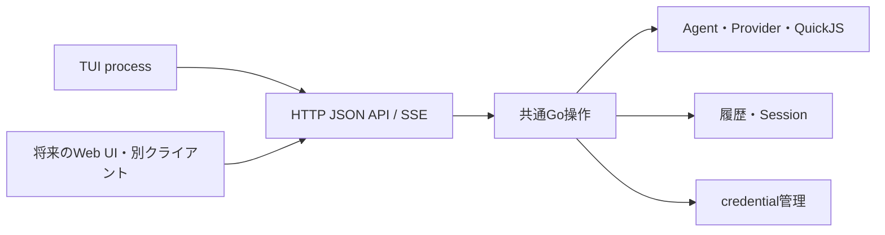

# I-05：コアとTUIの分離

> **後続変更の案内（2026-10-16）**：Core/TUI分離は実装済み。以下のAPI v1・終了キー・選択の非永続化は当時の契約。現行は[API v2](../design/http-api.md)、[TUI契約](../design/tui.md)、[detach／Core停止](../results/i07-session-management.md)、[workspaceの記憶selection](../results/remembered-model-selection.md)に従う。

2026-10-10。利用者はTUIを独立したコンポーネントにし、コアを軽くすることを指定した。
将来のWeb UIと独立した別クライアントからの接続も想定し、通信方式は**HTTP＋JSON＋SSE**に確定した。
従来のTUI操作改善案を、この計画へ置き換える。
通常review・批判的reviewと現行henji-harnessのsource確認を完了し、指摘を以下へ反映した。
通常・批判的再reviewはともにready。新規Session公開時の予約順序も解消を確認した。
利用者の指示により実装・テスト・実利用確認・実装reviewを完了した。
採用した実装指摘5件を修正し、通常・批判的再reviewはともにready。
[実装結果](../results/i05-core-tui-separation.md)に確認経路・配布物・観測値・未確認範囲を記録した。

## 採用した範囲

確定した要件は、コアとTUIの分離、コアからTUI依存を外すこと、HTTP＋JSON＋SSEによる通信、
Web UIや別クライアントにも利用できる公開操作である。
以下の実行ファイル名・endpoint・実行寿命・接続復元を、この要件を具体化する契約として実装した。
現行TUIの操作を通信越しに成立させることをI-05の中心とし、選択画面・補完・会話scroll改善は後続へ回す。

## 必要な動作と根拠

利用者はGoコアを起動し、別processのTUIから日本語の依頼を送れる。
モデル本文・tool・子Agentの途中経過を受信し、実行キャンセル、最終回答、Sessionの閲覧・再開、
provider/model/roleの変更、ChatGPTログインを現在の操作から利用できる。
TUIがDB・VM・provider・credentialを直接所有せず、同じAPIを別クライアントから使えることを完成条件とする。

今回の根拠は利用者の明示指定と、I-01〜I-04で成立した現行product経路である。
旧HenjiのHTTP方式は参考であり、旧Core・queueや全HTTP endpointの移植を要求しない。
HTTP＋JSONとSSEは公開通信方式として採用する。
[SSEの標準仕様](https://html.spec.whatwg.org/multipage/server-sent-events.html)に従い、
進捗を一つのHTTP responseから継続して受信する。イベントごとに別HTTP requestは作らない。

## 現行経路と分離後の経路

現行は`cmd/hjh → tui.Run → app.Service.Run → app.Run → agent/provider/QuickJS → history`。
TUIのBackendはServiceの公開操作を使うが、同一processであり、実行contextと終了時joinもUI側から接続する。
`cmd/hjh`がTUIをimportし、TUIはAPI型のためapp・history・extensions・providers・credentialsをimportしている。
型だけを共有していても、そのpackageの依存はコンポーネント分離の確認対象となる。

分離後は次の構成とする。

| 所有者 | 分離後の責務 |
| --- | --- |
| コアapp | role/selection解決、Agentの実行・取消・join、保存、正常rootの会話採用 |
| コアの実行管理 | APIから開始されたrunの識別、context、現在状態、進捗購読、terminal結果 |
| HTTP層 | JSON request/response、SSE配信、公開DTOと共通Go操作の対応付け |
| 公開API契約 | 依頼・結果・Session・一覧・inspection・観測・エラーの通信形式。UI・DB・VMへの依存を持たない |
| クライアント | HTTP操作とSSEの受信、通信エラー、購読contextの管理 |
| TUI | draft、表示、Session/次runの選択、停止要求、terminal操作 |

HTTP handlerはAgent loopやSQLを持たない。TUIはServiceを直接呼ばず、通信クライアントを呼ぶ。
共通DTOにapp/history/provider実装の型を埋め込まず、サーバー側で対応付ける。
これはwire契約の分離であり、DBの保存payloadやschemaを変更するものではない。

## 起動・配置

- `hjh serve --workspace PATH --db PATH --config PATH --listen 127.0.0.1:PORT`でコアを起動する。
- `hjh-tui --endpoint http://127.0.0.1:PORT`で独立TUIを接続する。
- コアの既存`hjh run`・`--stream`・一覧/履歴/認証CLIは引き続き共通Go操作を使う。
- 同一processの`hjh tui`入口は独立実行ファイルへ置き換える。コアがGUI依存をimportするlauncherは作らない。
- repositoryは共通のままで、別の`cmd`とbuild targetを設ける。Go module分割や別repositoryは今回必須にしない。

最初の配置は現在のLinux/amd64上でコアとTUIを動かす。
workspace・config・DBのpathはコア側のfilesystemを指し、TUIのcwdから暗黙に解決しない。
Session再開はコアの保存workspaceを使う。APIから別workspaceを指定する場合もコア上のpathである。
既存のAPIキー参照とOAuth保存先はコアに置き、TUIへcredential値を渡さない。
Web UIの実装と外部公開配置は今回行わない。

## 公開操作

APIは`/api/v1`配下に置く。識別、寿命、request/response例、SSEと設定の対応は
[HTTP API契約](../design/http-api.md)に記載した。以下はその公開操作である。
SDKをimportしないクライアントも、この文書から依頼・購読・停止を実装できるようにする。

| 操作 | endpoint案 | コアの既存操作との関係 |
| --- | --- | --- |
| Core情報 | `GET /core` | 起動ごとのcoreId、API version、既定workspaceを取得 |
| run開始 | `POST /runs` | client生成runId・task・Session・workspace・partial selection・role・実行optionを受け、管理対象runを開始 |
| run状態・結果 | `GET /runs/{runId}` | 準備中、実行中、終了と、判明したSession/execution ID・最終結果を返す |
| 進捗購読 | `GET /runs/{runId}/events` | SSEで親子の観測とterminal結果を受信 |
| 実行キャンセル | `POST /runs/{runId}/cancel` | root contextを取消し、親子終了・保存完了を状態/結果から確認 |
| Session一覧・取得 | `GET /sessions`、`GET /sessions/{id}` | Service.Sessions/Session |
| 採用会話・execution一覧 | `GET /sessions/{id}/conversation`、`GET /sessions/{id}/executions` | Service.Conversation/Executions。turn範囲を指定できる |
| execution証拠 | `GET /executions/{id}` | Service.Inspect。ordinal範囲と親子の証拠を取得 |
| role・接続・model一覧 | `GET /roles`、`GET /providers`、`GET /models` | Sessionまたはworkspaceからrunと同じ設定を解決するcatalog操作 |
| ChatGPT認証 | `GET /auth/status`、`POST /auth/login`、`POST /auth/complete` | 同じ設定解決を使い、コアManagerがURL発行・callback完了・token保存を所有 |

Providerやroleの選択はrun requestに含め、TUI専用の選択状態をサーバーへ新たに永続化しない。
Session保存selection・role、子roleの既定値、正常rootだけの会話採用はI-04の契約を維持する。
model一覧は候補であり、一覧にないmodel IDの指定を制限しない。

HTTP成功とAgent作業成功は区別する。SSEのHTTP 200や本文deltaだけで正常完了と判断せず、
terminal結果のoutcomeとerrorを使う。準備段階でexecution IDが未発行の失敗もrun結果で表示できる。
HTTPエラーはcode/messageを持つJSON、stream開始後の作業結果はterminal eventとして扱う。
秘密値を持たない認証参照・ログイン状態を公開し、APIキー・access/refresh token・Authorizationを返さない。

## 実行寿命・購読

| 操作・事象 | 効果 |
| --- | --- |
| 実行キャンセル | 指定runの親子を取り消し、join・終了保存まで待つ。Coreは使い続けられる |
| Core終了 | 管理runをキャンセルし、run・Worker・認証操作をjoinしてService・DBを閉じる |
| TUI離脱・購読切断 | 通信と表示を閉じる。この事象だけではrunもCoreも終了しない |

通常のEscは実行キャンセル後もTUIを残す。Ctrl+C・`/quit`は自分のforeground runを
キャンセルし、terminal結果を確認してTUIを終了する。`/new`・`/resume`も実行中なら
キャンセルとterminal確認を済ませてからSessionを切り替える。接続contextの取消だけで
完了扱いにしない。キャンセルrequestには、解除済みの購読contextを使わない。
TUIの通常終了は上表の実行キャンセルと離脱の組合せであり、共有Coreの終了ではない。
専用の離脱コマンドやTUIからのCore終了コマンドは今回追加しない。

runのcontextはCoreが所有し、POST/SSEのrequest寿命から独立させる。
clientはPOST前にrunIdを生成する。同じCoreで開始responseを見失っても、そのIDで状態を
問い合わせられる。同じID・同じ依頼の再送は同じrunを返し、二重実行しない。
coreIdが変わった場合は再起動を表示し、未確認の依頼を新しいrunとして自動再送しない。
runIdはAPI識別子、executionIdは保存証拠の識別子とする。
受理は準備完了を意味せず、preparing中も結果参照・キャンセルを可能にする。

公開terminalは`Service.Run`のreturn後に確定する。準備失敗、子/Workerのjoin、終了保存、
正常rootの会話採用とそのerrorを含めて返し、DBに終了recordがあるだけでは完了通知しない。
実行管理はterminal結果と開始依頼の識別をCoreの生存中保持する。
準備失敗でexecutionIdがない場合も参照できる。全観測payloadの別保存は行わず、
完了後の表示snapshotは既存historyと保持した結果から復元する。
Core再起動をまたぐrunの継続・開始再送保証は今回扱わない。

SSEは初回・再接続ともsnapshotから始める。run管理の通しseqでsnapshotと更新の境界を
決め、Observation.IDや親子別の保存ordinalをcursorに流用しない。
本文はexecutionId/modelStepごとの累積値を置き換え、親子・tool状態もIDで更新する。
サーバーのobserverは状態更新と配信通知までを行い、HTTP writeを待たない。
購読ごとの配信処理は低速受信中の更新を最新状態へまとめ、snapshotで追い付ける。
履歴recordを漏れなく読む経路はinspectであり、SSEを全recordの監査用再送としない。
固定の配信buffer上限・購読上限や旧Henjiの数値は引き継がない。

初版TUIは従来どおり一つのforeground runを扱う。APIでは同じ既存Sessionのrootを
準備開始前からterminalまで予約し、重複開始には`session_busy`とactive runIdを返す。
採用時のrevision競合を、同じCoreから受け付けた二つのrunの実作業後に発覚させない。
この予約はHTTP Core内の同一Sessionに対するものとし、全Session共通の実行slotやqueueは作らない。
新規Sessionもrun管理がIDを先に予約し、内部optionで共通Go操作のCreateSessionへ渡す。
DB公開後のadmission通知だけで予約する方式は使わない。作成済みSessionを準備中に一覧から
見つけた別clientが、そのSessionへ同時開始できる空白をなくす。
別processの既存CLIが同じDBへ書く場合は既存の採用競合があり得る。そのerrorもterminalへ反映し、
今回新たなprocess間lockやschedulerを追加しない。

ChatGPTのpending loginとcallback listenerはCoreのcontextに属する。
URLを返したHTTP requestの終了では破棄しない。完了操作もCore所有の操作としてjoin対象とし、
Core終了時はpending listenerとtoken交換を終了・joinしてからcredential管理を閉じる。

workspaceはSessionの保存値、明示workspace、serve既定値の順で解決する。
catalog/authにも同じSession/workspaceを渡し、明示`--config`はCore側で共通に適用する。
`maxSteps`・`fromTurn`はrunごとの省略可能fieldへ対応付け、省略と明示0を区別する。
DB/config/credential-fileはCore起動option、Session/model/provider/role/effort/auth-profileと
max-steps/from-turnはTUIから送るrun optionとする。詳細はHTTP API設計案の対応表を参照する。

## 実装の責務と順序

1. HTTP API設計案に沿って公開DTOを定義する。既存queryの結果fieldを対応付け、
   独立clientが使うJSON契約を文書に揃える。今回決めた識別・寿命・設定解決を実装都合で変えない。
2. appの外側にAPI run管理とHTTP層を設け、開始・購読・状態・停止・履歴・catalog・認証を接続する。
   保存や会話採用を複製せず、既存Service/Runを使う。
3. 独立したHTTPクライアントとTUI入口を設け、TUI Backendと型参照を公開DTOへ置き換える。
   TUI.Closeは自分の通信を閉じ、Service/DBの終了を行わない。
4. cmd/hjhからTUI入口/importを外し、非対話CLIを確認する。
   同一process専用Backendや使われなくなる型変換も置き換え箇所と同時に整理する。
5. Linux配布をコア/TUIの別binaryへ対応させ、両binaryの依存・license・manifestと起動説明を更新する。
   コアだけを使う場合にTUIを必須にしない。

通信層・実行管理・API契約・クライアント・表示は責務ごとに配置する。
ディレクトリ名は実装時に決めるが、コアからTUIへ、TUI/共通DTOからapp・DB・VMへ依存する方向を作らない。
Agent loop、provider protocol、外部JS、履歴schemaの機能変更は今回に含めない。

## 確認と受入条件

| 必要なproduct動作 | 確認方法 |
| --- | --- |
| 独立TUIから実依頼を完了する | 別processのコアとTUIを実PTYで起動し、日本語・複数行依頼、実ファイル作業、本文/tool/子の進捗、最終結果を確認 |
| 接続・roleを変更してSessionを続ける | 既存コマンドを通信越しに使い、保存selection/roleと次runの実使用値を確認 |
| 保存会話・失敗/取消・親子の証拠を読める | TUIを別起動し、Session picker/再開/history/executions/inspectから既存証拠を確認 |
| キャンセルと終了が保存完了へつながる | 実PTYでEsc・Ctrl+C・quitを使い、子の取消・terminal保存を確認。new/resumeも旧runの完了後に切り替わること、Core終了のjoinをfocused確認 |
| 開始responseを失ってもrunを見つける | 同じCoreへPOSTした後、responseを読まず接続を閉じ、既知runIdで結果を取得。同じIDの再送でexecutionが増えないことを確認 |
| 同じSessionで作業が二重に始まらない | preparing/実行中のSessionに別runを送ってactive runIdを確認し、既存run終了後に続行できることをfocused確認 |
| 購読開始が遅れても状態を読める | 最初の購読前に本文/完了へ進む経路を確認し、snapshotから表示できることを確認 |
| 通信切断とキャンセルを区別できる | 購読解除/低速受信で実行が止まらないこと、再購読で本文が重複しないこと、キャンセルAPIで終了を確認できることを確認 |
| 再開Sessionの設定を使える | serve既定とは別workspaceのSessionを再開し、role/model catalog・認証とrunが同じ設定を読むこと、maxSteps/fromTurnを維持することを確認 |
| 第三者クライアントが接続できる | TUI/Goクライアントを使わず、Python標準HTTP等から公開JSON/SSE契約だけで依頼・途中経過・結果・履歴を確認 |
| コアのTUI依存とTUIの実行基盤依存が外れる | go list -depsとbuild metadataでコアからBubble Tea/Bubbles等、TUIからSQLite/QuickJS/app実装が外れたことを確認 |
| 非対話CLIも使える | 既存run/stream・閲覧経路のfocused確認と最終全体test |

ChatGPTの認証操作はコアに既存Managerを接続し、認証状態・model catalog・callback完了がHTTP越しに扱えることを確認する。
login開始response終了後のpending認証はCore所有として確認する。
既存の有効な認証を再利用し、保存済み認証でのHTTP model取得と実runを確認する。
利用者は検証のために再認可を繰り返すことを望まないため、今回の新規ブラウザcallback完了の
実確認は対象から外し、変更したHTTP経路のsource確認と既存認証testを使う。
通常利用に実際の認証切れが生じた場合だけ、再認可を依頼する。
全providerで同じ実作業を繰り返さず、I-04で接続済みの経路を使い、今回変わる通信・UI操作を実確認する。
使用model、workspace、端末寸法、停止/再接続結果と未確認範囲を結果文書へ記録する。

機能実装後に対応するfocused testを追加する。fixtureだけで独立TUIや公開APIの完成とはしない。
実装中はfocused test、format、必要なvet、whitespace確認を使う。
実行寿命・購読・joinの並行処理へfocused race確認を行う。
安定候補の全体testはcoordinating ownerが一度実行する。
Linux配布物からコア/TUIを別processで動かして作業を確認する。release公開は含めない。

コアとTUIのbinaryサイズ、起動時メモリは観測値として記録する。
通信方式を選んだこと自体を性能改善の実測と扱わず、削減量の推測値や数値目標を置かない。

## Reviewの反映と参考source

通常reviewは公開契約と現操作の対応、実依頼完了、型の依存方向、停止/保存、非対話CLIのregressionを確認する。
批判的reviewは、切断をcontext取消へ誤変換していないか、購読開始の空白、snapshot/liveの整合、
一時状態と保存の重複、クライアントがコア実装に依存する経路を確認する。
一般的なhardeningや未観測provider variantを今回のreviewへ追加しない。

| 初回reviewの指摘 | 反映先・判断 |
| --- | --- |
| P1：login request終了でpending認証が消える | pending/完了操作をCore所有にし、response終了後の実認証を受入条件へ追加 |
| P2：再開Sessionのcatalog/auth設定が一致しない | runと同じSession優先のworkspace/config解決を全操作で使用 |
| P2：既存startup optionが落ちる | maxSteps/fromTurnはrun field、credential-file等はCore optionとして対応を明記 |
| P2：new/resumeが実行完了前に切り替わる | 明示キャンセルとterminal確認後に切替。購読取消は完了と扱わない |
| P2：開始response喪失でrunIdが分からない | client生成runId、同一IDの参照/再送、coreIdによる再起動の区別 |
| P2：同じSessionのrootが実作業後に採用競合する | Core内のSession予約を準備前からterminalまで保持 |
| cursor・配信・完了通知・完了run保持の具体化 | run seq、snapshot復元、observerとwriteの分離、Service.Run return後のterminal、Core生存中の結果参照 |

これらは分離後の契約の不足として採用した。現行productに同じ不具合が存在するとの判断ではない。
通常再reviewは既存3件の解消を確認しreadyとした。批判的再reviewも既存指摘と
新規Sessionの事前予約の解消を確認しreadyとした。これは設計上の判定であり、
実装・実通信・provider動作の確認を代替しない。

現行henji-harnessの実sourceをread-onlyで確認した。採用する参考と差分は
[HTTP APIの参考source](../design/http-api.md#現行henjiからの参考と差分)へ記録した。
開始前のcommand識別、snapshotと更新の境界、Core所有の認証、準備中の実行予約、settlementは参考にした。
旧`/quit`のCore終了、固定workspace、全体slot、Data/API Worker、queue、buffer数値は移植しない。

HTTP＋JSON＋SSEと分離方針、および上記の詳細をI-05として実装した。
Web UI、remote公開運用、Session queue、入力/画面の操作改善、Agent loop外部化、コンテナ/OS VMは後続とする。
